<!-- Animated Contribution Graph: Real GitHub data, boxes cascade diagonally.
     Regenerated daily at 06:17 UTC by .github/workflows/update-profile-art.yml -->

<h3><code>meet@github ~ $ ./contributions.sh</code></h3>

 
 

<!-- ASCII Portrait (left) + Streak & Stats Card (right).
     Both SVGs are 840x880 so equal widths give identical heights.
     Portrait: python scripts/prep_photo.py <photo> && python scripts/make_ascii_svg.py
     Stats:    python scripts/render_stats_svg.py (auto-refreshed daily) -->

<h3><code>meet@github ~ $ whoami</code></h3>

<table>
  <tr>
    <td valign="top">
      
    </td>
    <td valign="top">
      
    </td>
  </tr>
</table>

 
 

<h3><code>meet@github ~ $ neofetch</code></h3>

 
 

<h3><code>meet@github ~ $ ./skills.sh</code></h3>

<em>Focusing on robust backend architectures, distributed systems & applied AI/ML.</em>

  
  
  
  
  
  
  

  
  
  
  
  
  
  

 

<h3><code>meet@github ~ $ ./projects.sh --featured</code></h3>

| Project | Description | Tech Stack | Repository |
| :--- | :--- | :--- | :--- |
| **CargoIntel** | AI-powered X-ray cargo inspection using YOLOv8 for prohibited item detection | `JavaScript` `YOLOv8` `AI/ML` | [Meetrao/CargoIntel](https://github.com/Meetrao/CargoIntel) |
| **VoteChain** | Decentralized e-voting platform featuring blockchain & biometric AI verification | `JavaScript` `Blockchain` `AI` | [Meetrao/VoteChain](https://github.com/Meetrao/VoteChain) |
| **Warehouse Management System** | Complete backend system for inventory, order processing, and warehousing | `Python` `Backend` `Database` | [Meetrao/WarehouseManagementSystem](https://github.com/Meetrao/WarehouseManagementSystem) |

 
 

<h3><code>meet@github ~ $ ./contact.sh</code></h3>

  
  
  
  

 

